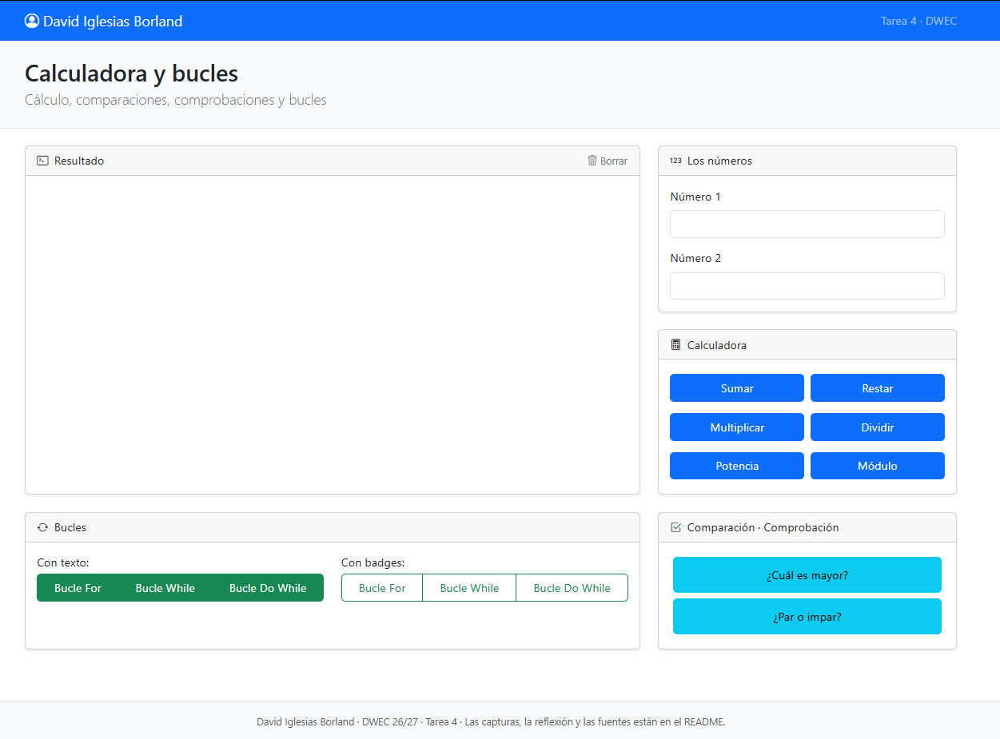
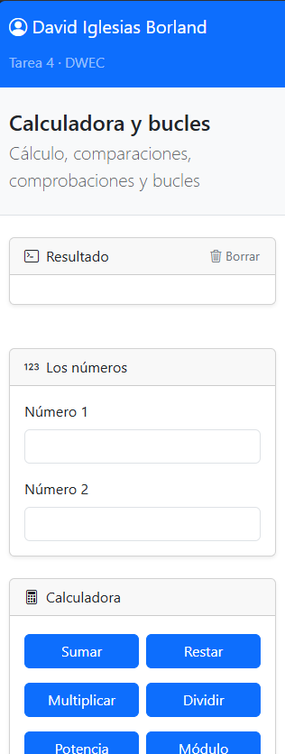
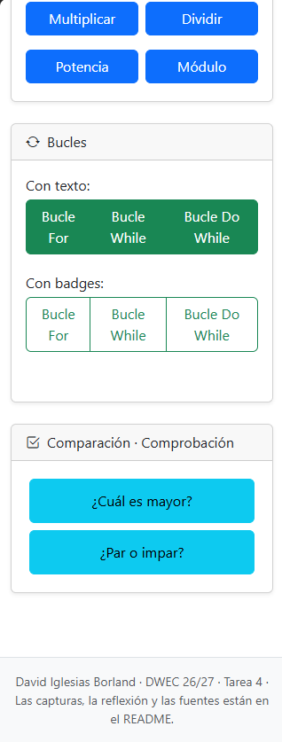
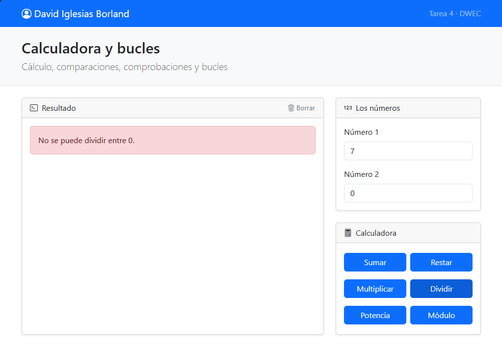
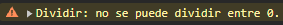
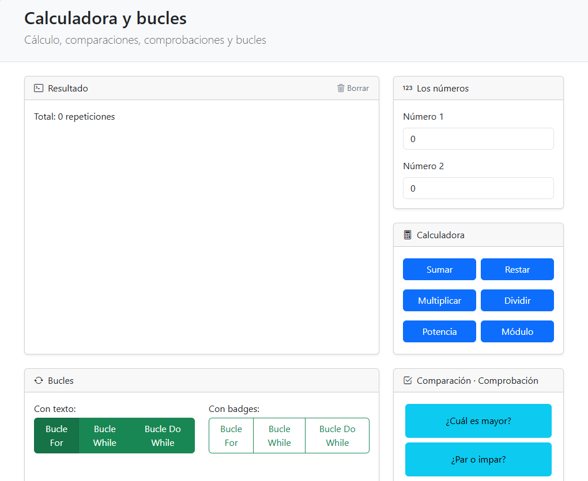
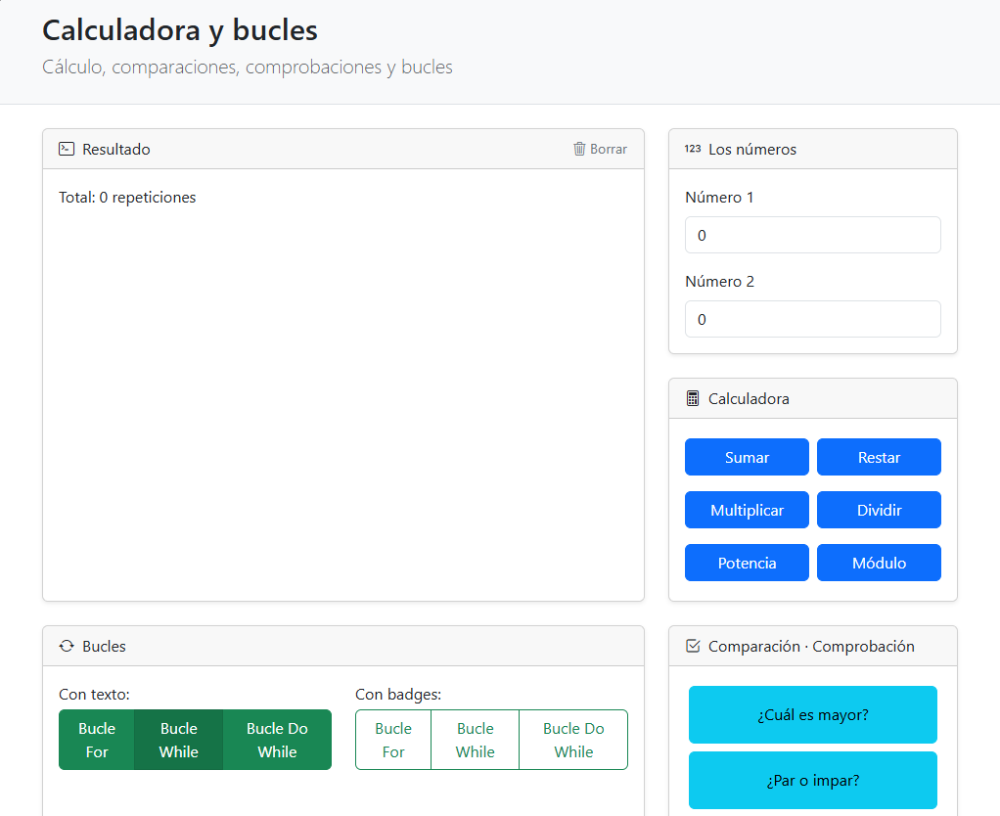
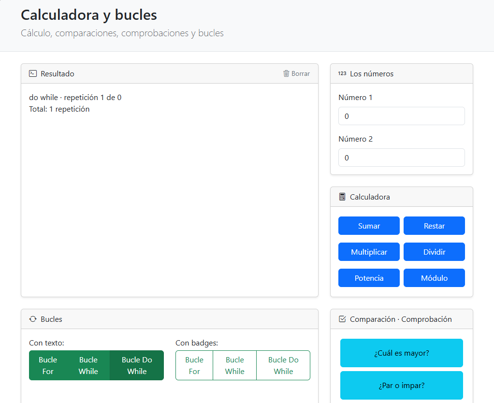
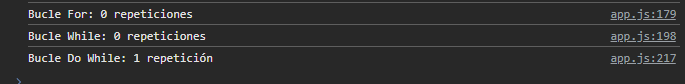
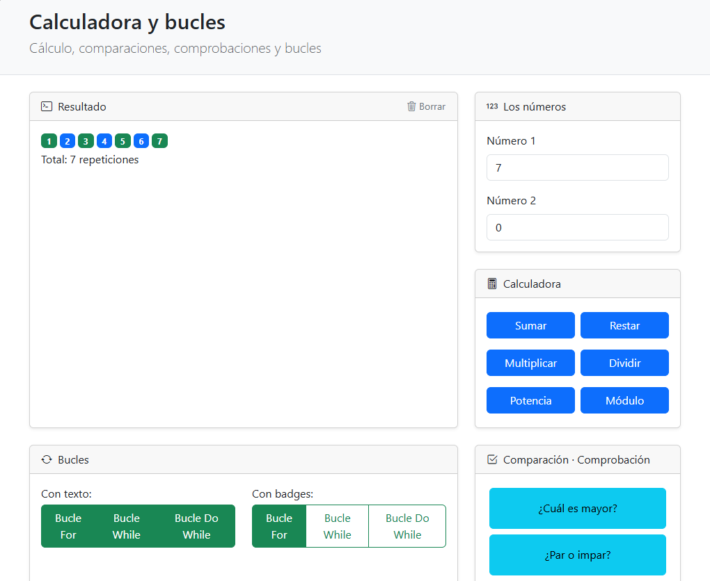

# Tarea 4 · Calculadora y bucles

| | |
|---|---|
| **Autor** | David Iglesias Borland |
| **Módulo** | Desarrollo Web en Entorno Cliente (DWEC) |
| **Curso** | 2.º DAW · 2026-27 |

---

## Índice

1. [Descripción](#descripción)
2. [Estructura de carpetas](#estructura-de-carpetas)
3. [Vista general](#vista-general)
4. [Apartados](#apartados)
   - [Apartado c · El error de dividir entre 0](#apartado-c--el-error-de-dividir-entre-0)
   - [Apartado d · Los tres bucles con el número 0](#apartado-d--los-tres-bucles-con-el-número-0)
   - [Apartado e · Un bucle con badges](#apartado-e--un-bucle-con-badges)
5. [Reflexión](#reflexión)
6. [Uso de IA](#uso-de-ia)
7. [Fuentes](#fuentes)

---

## Descripción

Página web maquetada con Bootstrap que funciona como una calculadora sencilla y sirve para practicar los bucles de JavaScript. Incluye un control de errores al dividir entre 0, la comparación de los bucles `for`, `while` y `do...while` con el número 0 y un bucle que genera badges de colores según el número sea par o impar.

---

## Estructura de carpetas

```text
tema04/
├── capturas/
│   ├── a-pagina.png
│   ├── b-movil1.png
│   ├── b-movil2.png
│   ├── c-dividir-cero1.png
│   ├── c-dividir-cero2.png
│   ├── d-bucles-ceroconsola.png
│   ├── d-bucles-cerodowhile.png
│   ├── d-bucles-cerofor.png
│   ├── d-bucles-cerowhile.png
│   └── e-badges.png
├── js/
│   ├── app.js        # Funciones de la calculadora y de los bucles
│   └── ayudas.js     # Funciones que leen las casillas y escriben el resultado
├── index.html        # Página principal maquetada con Bootstrap
└── README.md
```

---

## Vista general

<table>
  <tr>
    <td colspan="2" align="center">
      <br>
      <sub><b>a)</b> La página entera, con todas las funciones y su maquetación.</sub>
    </td>
  </tr>
  <tr>
    <td align="center">
      
    </td>
    <td align="center">
      
    </td>
  </tr>
  <tr>
    <td colspan="2" align="center">
      <sub><b>b)</b> La página en el móvil: se comprueba su comportamiento <i>responsive</i>.</sub>
    </td>
  </tr>
</table>

---

## Apartados

### Apartado c · El error de dividir entre 0

**Objetivo:** controlar el error que se produce al dividir entre 0.




**Resultado:** al hacer una división entre 0, la página aplica el control de errores en lugar de mostrar un resultado.

### Apartado d · Los tres bucles con el número 0

**Objetivo:** ejecutar los bucles `for`, `while` y `do...while` con el número 0 y comprobar cuántas veces se repite cada uno.



**Resultado (`for`):** el bucle se repite cero veces. El contador empieza en 0 y el bucle solo se ejecuta mientras sea menor que el número de repeticiones `x`; como `0 < 0` es falso desde el principio, no llega a entrar.



**Resultado (`while`):** el bucle se repite cero veces porque la condición `contador !== x` es falsa desde el principio (`0 !== 0` es `false`), así que nunca entra en el bucle.



**Resultado (`do...while`):** el bucle se repite una vez. Funciona como `while`, pero comprueba la condición después de cada vuelta, por lo que el cuerpo siempre se ejecuta al menos una vez.



**Resultado (consola):** se pueden comprobar los `console.log()` de las diferentes funciones y las repeticiones de cada bucle.

### Apartado e · Un bucle con badges

**Objetivo:** generar con un bucle una serie de badges de Bootstrap.



**Resultado:** con el número 7 se muestran las badges. Para que cambien de color usé el operador ternario, que elige el color según el número sea par o impar. Me habría gustado crear una función que devolviera un booleano (par o impar) para reutilizarla aquí, pero quise ceñirme a la rúbrica.

---

## Reflexión

Los tres bucles se diferencian principalmente por cómo se declaran. El bucle `for` está pensado para repetirse un número de veces conocido (`x`), mientras que `while` y `do...while` no necesitan conocer de antemano cuántas veces se van a repetir. Eso sí, los tres comparten algo: dependen de que se cumpla una condición. El bucle `do...while` es el más diferente, porque siempre ejecuta su cuerpo al menos una vez.

---

## Uso de IA

La estructura, el formato y la revisión ortográfica de este README se hicieron con ayuda de **Claude** (Anthropic), a partir de mi redacción original.

---

## Fuentes

- [Bootstrap · Documentación oficial](https://getbootstrap.com/docs/)
- [W3Schools · JavaScript Tutorial](https://www.w3schools.com/js/)
