# Tarea 5 · Manipular el DOM

| | |
|---|---|
| **Autor** | David Iglesias Borland |
| **Módulo** | Desarrollo Web en Entorno Cliente (DWEC) |
| **Curso** | 2.º DAW · 2026-27 |

---

## Índice

1. [Descripción](#descripción)
2. [Estructura de carpetas](#estructura-de-carpetas)
3. [Vista general](#vista-general)
4. [Ejercicios](#ejercicios)
   - [Ejercicios 1 y 2 · Modificar y añadir párrafos](#ejercicios-1-y-2--modificar-y-añadir-párrafos)
   - [Ejercicio 3 · Resaltado al pasar el ratón](#ejercicio-3--resaltado-al-pasar-el-ratón)
   - [Ejercicio 4 · Insertar HTML con innerHTML](#ejercicio-4--insertar-html-con-innerhtml)
   - [Ejercicio 5 · La lista de tareas](#ejercicio-5--la-lista-de-tareas)
   - [Ejercicio 6 · Los datos de la ventana](#ejercicio-6--los-datos-de-la-ventana)
5. [Reflexión](#reflexión)
6. [Uso de IA](#uso-de-ia)
7. [Fuentes](#fuentes)

---

## Descripción

Página web con JavaScript para practicar la manipulación del DOM: modificar y añadir párrafos, reaccionar a eventos del ratón, insertar contenido con `innerHTML` y `textContent`, gestionar una lista de tareas y mostrar los datos de la ventana. Para probarla, basta con abrir la carpeta en VS Code, pulsar **Go Live** y usar los botones con la consola abierta (F12).

---

## Estructura de carpetas

```text
tema05/
├── capturas/
│   ├── a-pagina.png
│   ├── b-ej1-ej2.png
│   ├── b-ej1-ej2-2.png
│   ├── c-ej3-resaltado.png
│   ├── c-ej3-resaltado-2.png
│   ├── d-ej4-innerhtml.png
│   ├── d-ej4-innerhtml-2.png
│   ├── e-ej5-lista.png
│   ├── e-ej5-lista-2.png
│   ├── e-ej5-lista-3.png
│   ├── f-ej6-movil.png
│   └── f-ej6-movil-2.png
├── js/
│   └── app.js        # Una función por cada botón de la página
├── index.html        # Página que se manipula desde JavaScript
└── README.md
```

---

## Vista general

<div align="center">
<table>
  <tr>
    <td align="center">
      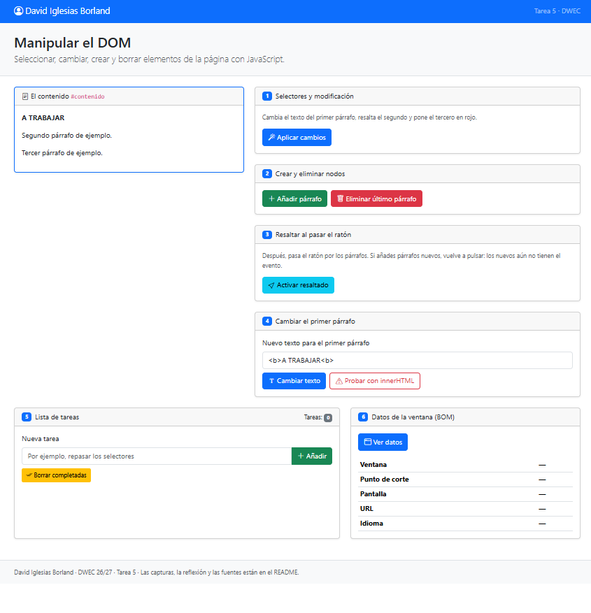<br>
      <sub><b>a)</b> La página completa: mi nombre en la navbar, el bloque <code>#contenido</code> con sus tres párrafos y las tarjetas de los seis ejercicios.</sub>
    </td>
  </tr>
</table>
</div>

---

## Ejercicios

### Ejercicios 1 y 2 · Modificar y añadir párrafos

**Objetivo:** seleccionar los párrafos de la página para modificarlos y añadir párrafos nuevos.

<div align="center">
<table>
  <tr>
    <td align="center">
      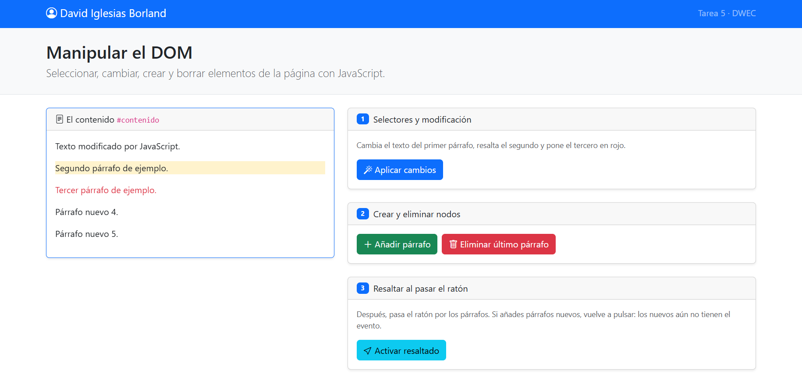<br>
      <sub>Los párrafos tras pulsar «Aplicar cambios» y dos veces «Añadir párrafo».</sub>
    </td>
  </tr>
  <tr>
    <td align="center">
      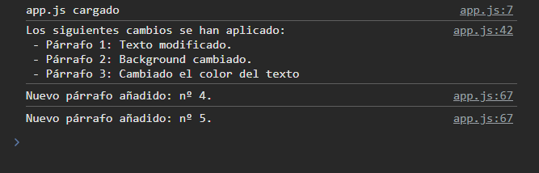<br>
      <sub>Consola con los mensajes de los cambios y de los párrafos añadidos.</sub>
    </td>
  </tr>
</table>
</div>

**Resultado:** al pulsar «Aplicar cambios», el primer párrafo pasa a decir «Texto modificado por JavaScript.», el segundo queda resaltado con fondo amarillo y el tercero cambia su texto a color rojo. Con «Añadir párrafo» se crean «Párrafo nuevo 4.» y «Párrafo nuevo 5.» al final del bloque. La consola confirma cada cambio y cada párrafo añadido.

### Ejercicio 3 · Resaltado al pasar el ratón

**Objetivo:** resaltar un párrafo cuando el ratón pasa por encima.

<div align="center">
<table>
  <tr>
    <td align="center">
      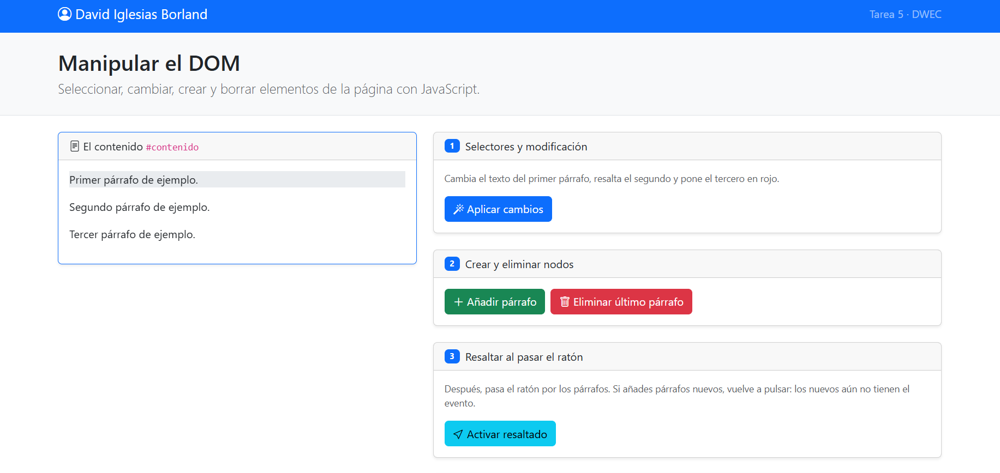<br>
      <sub>El primer párrafo, resaltado en gris al pasar el ratón por encima.</sub>
    </td>
  </tr>
  <tr>
    <td align="center">
      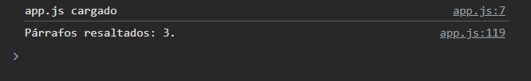<br>
      <sub>Consola tras pulsar «Activar resaltado».</sub>
    </td>
  </tr>
</table>
</div>

**Resultado:** después de pulsar «Activar resaltado», el párrafo sobre el que está el ratón se resalta con un fondo gris. La consola indica «Párrafos resaltados: 3.», es decir, el evento se ha asignado a los tres párrafos que había en ese momento.

### Ejercicio 4 · Insertar HTML con innerHTML

**Objetivo:** escribir `<b>Hola</b>` en el primer párrafo y comparar el resultado del botón «Cambiar texto» con el de «Probar con innerHTML».

<div align="center">
<table>
  <tr>
    <td align="center">
      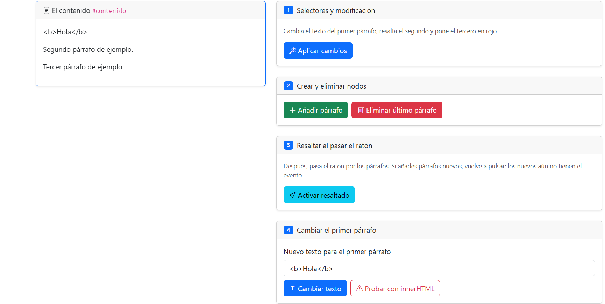<br>
      <sub>Con «Cambiar texto».</sub>
    </td>
  </tr>
  <tr>
    <td align="center">
      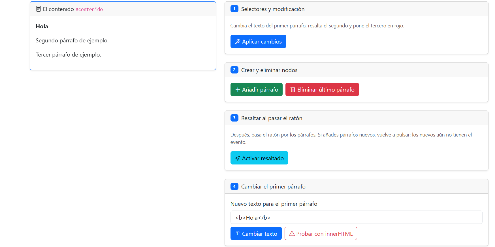<br>
      <sub>Con «Probar con innerHTML».</sub>
    </td>
  </tr>
</table>
</div>

**Resultado («Cambiar texto»):** el párrafo muestra literalmente `<b>Hola</b>`, con las etiquetas visibles: el HTML no se interpreta.

**Resultado (`innerHTML`):** el párrafo muestra **Hola** en negrita, porque el navegador interpreta la etiqueta `<b>`.

### Ejercicio 5 · La lista de tareas

**Objetivo:** crear una lista de tareas en la que se puedan añadir tareas, marcarlas como completadas y borrar las completadas.

<div align="center">
<table>
  <tr>
    <td align="center">
      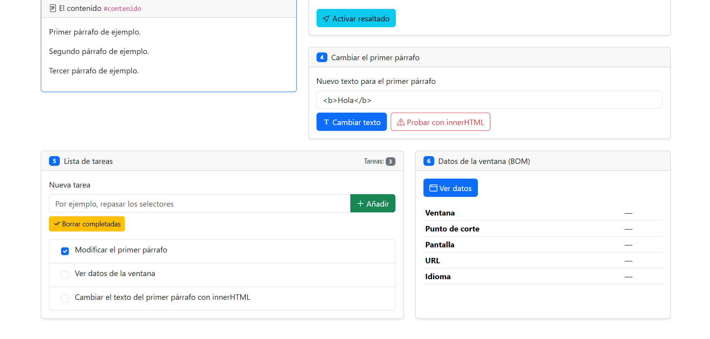<br>
      <sub>Tres tareas, con «Modificar el primer párrafo» marcada.</sub>
    </td>
  </tr>
  <tr>
    <td align="center">
      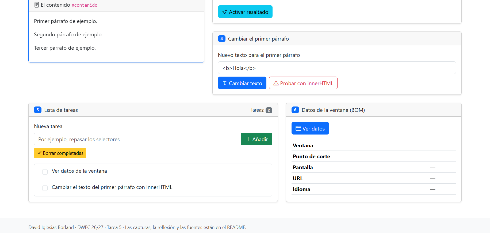<br>
      <sub>La lista después de pulsar «Borrar completadas».</sub>
    </td>
  </tr>
  <tr>
    <td align="center">
      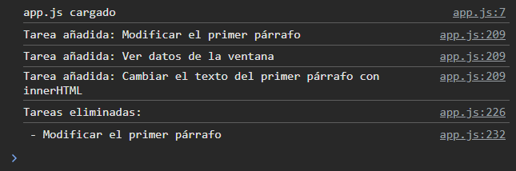<br>
      <sub>Consola con las tareas añadidas y la eliminada.</sub>
    </td>
  </tr>
</table>
</div>

**Resultado:** se añaden tres tareas y el contador muestra «Tareas: 3». Al marcar «Modificar el primer párrafo» y pulsar «Borrar completadas», esa tarea desaparece y el contador baja a 2. La consola registra las tres tareas añadidas y la tarea eliminada.

### Ejercicio 6 · Los datos de la ventana

**Objetivo:** mostrar los datos de la ventana y comprobar cómo cambian entre el móvil y el ordenador.

<div align="center">
<table>
  <tr>
    <td align="center">
      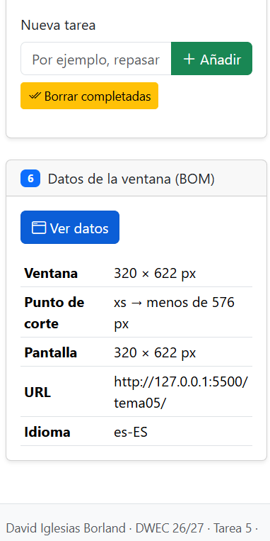<br>
      <sub>Móvil.</sub>
    </td>
    <td align="center">
      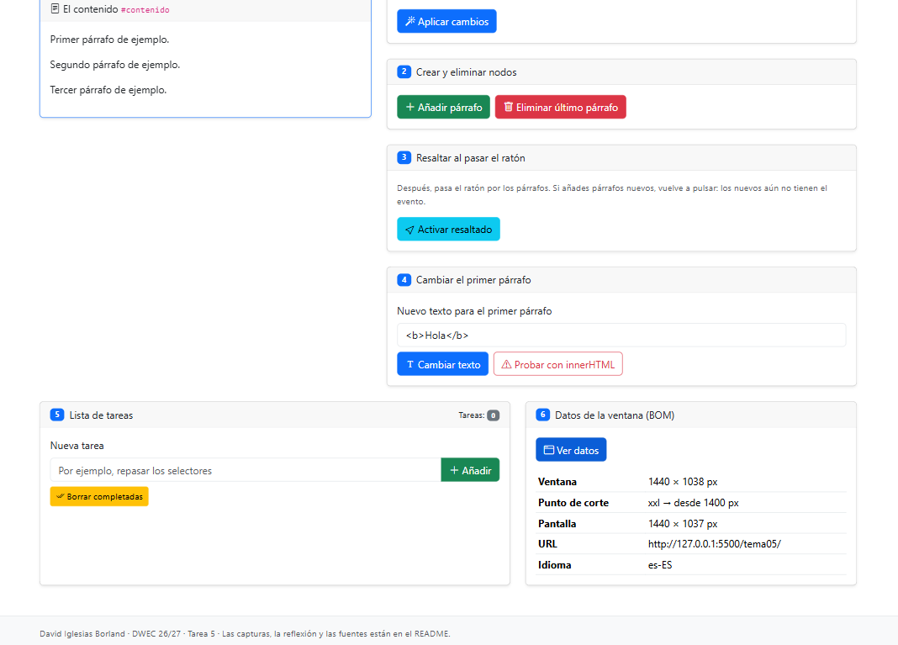<br>
      <sub>Ordenador.</sub>
    </td>
  </tr>
</table>
</div>

**Resultado:** al pulsar «Ver datos», la tabla se rellena con la información de la ventana. Cambian el tamaño y el punto de corte de Bootstrap; la URL y el idioma son los mismos:

| Dato | Móvil | Ordenador |
|---|---|---|
| Ventana | 320 × 622 px | 1440 × 1038 px |
| Punto de corte | xs (menos de 576 px) | xxl (desde 1400 px) |
| Pantalla | 320 × 622 px | 1440 × 1037 px |
| URL | `http://127.0.0.1:5500/tema05/` | `http://127.0.0.1:5500/tema05/` |
| Idioma | es-ES | es-ES |

---

## Reflexión

Hay que tener mucho cuidado al usar `innerHTML` con datos introducidos por el usuario, ya que la página queda expuesta a ataques de *Cross-Site Scripting* (XSS). Usar `textContent` evita este problema, porque añade el texto plano sin interpretar el HTML.

---

## Uso de IA

La estructura, el formato y la revisión ortográfica de este README se hicieron con ayuda de **Claude** (Anthropic), a partir de mi redacción original.

---

## Fuentes

- [W3Schools · JavaScript Tutorial](https://www.w3schools.com/js/)
- [MDN Web Docs · JavaScript](https://developer.mozilla.org/es/docs/Web/JavaScript)
