# Tarea 6 · Objetos y arrays

| | |
|---|---|
| **Autor** | David Iglesias Borland |
| **Módulo** | Desarrollo Web en Entorno Cliente (DWEC) |
| **Curso** | 2.º DAW · 2026-27 |

---

## Índice

1. [Descripción](#descripción)
2. [Estructura de carpetas](#estructura-de-carpetas)
3. [Vista general](#vista-general)
4. [Ejercicios](#ejercicios)
   - [Ejercicios 1 y 2 · La ficha y los colores](#ejercicios-1-y-2--la-ficha-y-los-colores)
   - [Ejercicio 3 · El catálogo de productos](#ejercicio-3--el-catálogo-de-productos)
   - [Ejercicio 4 · Las notas y la media](#ejercicio-4--las-notas-y-la-media)
   - [Ejercicio 5 · map, filter y reduce](#ejercicio-5--map-filter-y-reduce)
   - [Ejercicio 6 · Ciudades: slice, splice y búsqueda](#ejercicio-6--ciudades-slice-splice-y-búsqueda)
5. [Reflexión](#reflexión)
6. [Uso de IA](#uso-de-ia)
7. [Fuentes](#fuentes)

---

## Descripción

Página web con JavaScript para practicar el trabajo con objetos y arrays: crear y modificar un objeto, añadir y quitar elementos de un array, ordenar una copia con una función de comparación, usar `map`, `filter` y `reduce`, y comparar `slice` con `splice`. Todas las funciones están escritas con `function`, sin funciones flecha. Para probarla, basta con abrir la carpeta en VS Code, pulsar **Go Live** y usar los botones con la consola abierta (F12).

---

## Estructura de carpetas

```text
tema06/
├── capturas/
│   ├── a-pagina-2.png
│   ├── a-pagina.png
│   ├── b-ej1-ej2-2.png
│   ├── b-ej1-ej2.png
│   ├── c-ej3-ordenado-2.png
│   ├── c-ej3-ordenado.png
│   ├── d-ej4-notas-2.png
│   ├── d-ej4-notas.png
│   ├── e-ej5-cadena-2.png
│   ├── e-ej5-cadena.png
│   ├── f-ej6-busqueda-2.png
│   ├── f-ej6-busqueda.png
│   ├── f-ej6-slice-2.png
│   ├── f-ej6-slice.png
│   ├── f-ej6-splice-2.png
│   └── f-ej6-splice.png
├── js/
│   └── app.js        # Una función por cada botón de la página
├── index.html        # Seis tarjetas, una por ejercicio
└── README.md
```

---

## Vista general

<div align="center">
<table>
  <tr>
    <td align="center">
      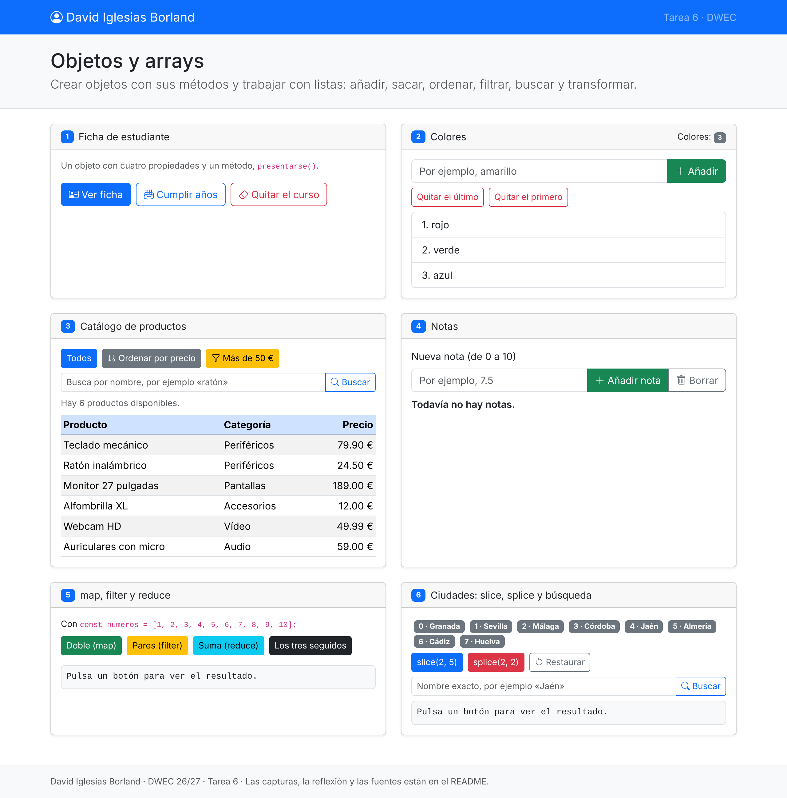<br>
      <sub><b>a)</b> La página recién cargada: mi nombre en la barra superior y las seis tarjetas de los ejercicios.</sub>
    </td>
  </tr>
  <tr>
    <td align="center">
      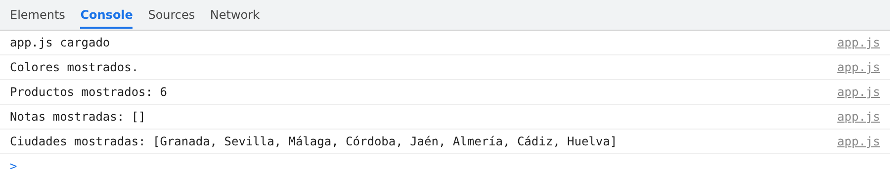<br>
      <sub>Consola al cargar la página.</sub>
    </td>
  </tr>
</table>
</div>

Nada más cargar la página se ve mi nombre en la barra de navegación y las seis tarjetas de la tarea: **Ficha de estudiante**, **Colores**, **Catálogo de productos**, **Notas**, **map, filter y reduce** y **Ciudades: slice, splice y búsqueda**.

---

## Ejercicios

### Ejercicios 1 y 2 · La ficha y los colores

**Objetivo:** modificar la ficha de un estudiante (un objeto con cuatro propiedades y un método) y gestionar una lista de colores (un array), añadiendo y quitando elementos.

<div align="center">
<table>
  <tr>
    <td align="center">
      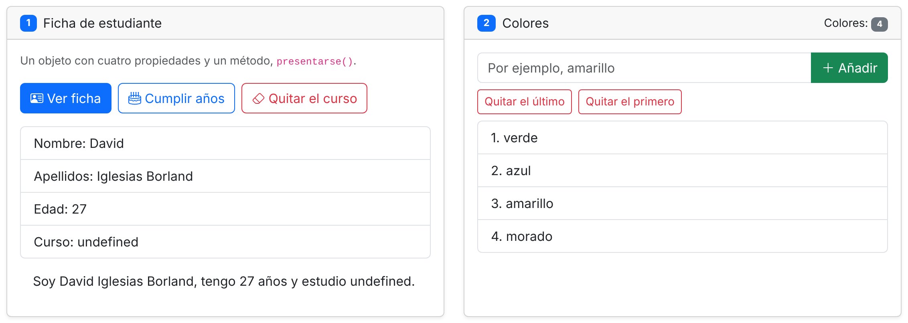<br>
      <sub>La ficha tras cumplir un año y quitar el curso, y la lista de colores tras añadir dos y quitar el primero.</sub>
    </td>
  </tr>
  <tr>
    <td align="center">
      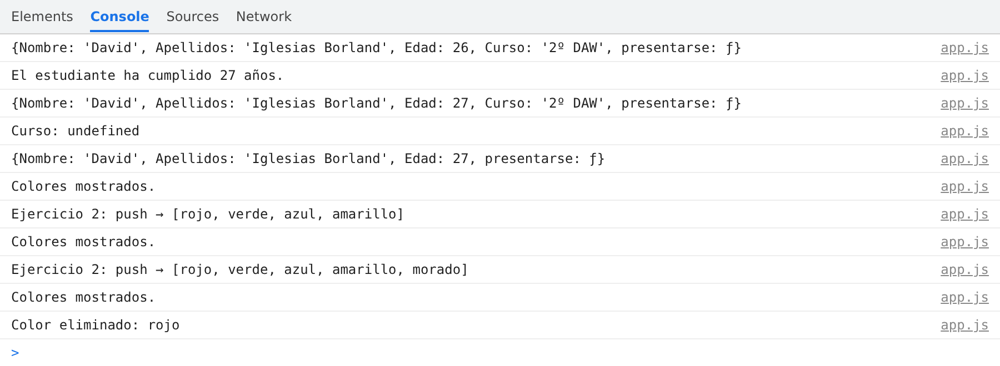<br>
      <sub>Consola con los cambios de la ficha y de los colores.</sub>
    </td>
  </tr>
</table>
</div>

**Resultado (ficha):** cada vez que se pulsa «Cumplir años», la edad sube en uno (27, 28, 29…) hasta llegar a 100. Como pequeño extra, al pulsar de nuevo cuando ya tiene 100 años, la edad se queda en 100 y el método `presentarse()` se sustituye, de modo que la frase de abajo pasa a decir «Dudo mucho que esta persona sea un alumno.».

Al pulsar «Quitar el curso», `delete` elimina la propiedad `Curso` del objeto original, y la ficha muestra `Curso: undefined`, porque esa clave ya no existe. Se sigue mostrando la línea porque las claves que se pintan están definidas a mano en un array (`["Nombre", "Apellidos", "Edad", "Curso"]`). Mi idea original era obtenerlas con `Object.keys(estudiante)`, pero entonces la línea del curso desaparecía al borrarlo.

**Resultado (colores):** cada color que se escribe se añade al final de la lista con `push`, sin límite. «Quitar el último» lo elimina con `pop` y «Quitar el primero», con `shift`; en ambos casos se vuelve a pintar la lista y se actualiza el contador. Si la lista ya está vacía, aparece el aviso «No hay colores que quitar dentro de la lista.».

### Ejercicio 3 · El catálogo de productos

**Objetivo:** mostrar el catálogo de productos, ordenarlo por precio sin modificar el array original, filtrar los de más de 50 € y buscar un producto por su nombre.

<div align="center">
<table>
  <tr>
    <td align="center">
      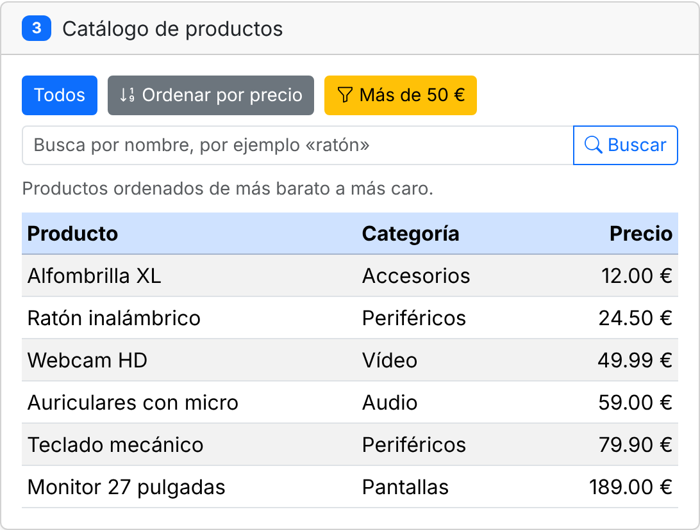<br>
      <sub>La tabla de productos ordenada de más barato a más caro.</sub>
    </td>
  </tr>
  <tr>
    <td align="center">
      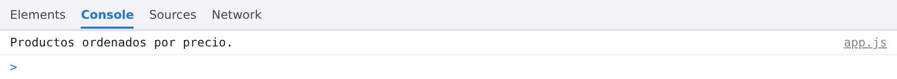<br>
      <sub>Consola tras ordenar por precio.</sub>
    </td>
  </tr>
</table>
</div>

**Resultado:**

- **Todos:** muestra los seis productos en su orden original.
- **Ordenar por precio:** ordena una copia del array con `sort` y una función de comparación (`a.precio - b.precio`), de modo que los productos aparecen del más barato (12,00 €) al más caro (189,00 €).
- **Más de 50 €:** con `filter` muestra solo los productos que cuestan más de 50 €.
- **Buscar:** con `find` busca el primer producto cuyo nombre contiene el texto escrito. Por ejemplo, «mecánico» encuentra el teclado mecánico y «con» encuentra los auriculares con micro. Justo debajo del buscador aparece el nombre del producto encontrado.

### Ejercicio 4 · Las notas y la media

**Objetivo:** añadir notas a un alumno, distinguiendo por color las aprobadas de las suspensas, y calcular su media.

<div align="center">
<table>
  <tr>
    <td align="center">
      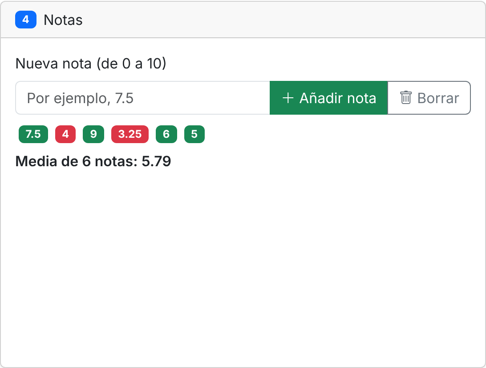<br>
      <sub>Seis notas, aprobadas en verde y suspensas en rojo, con su media.</sub>
    </td>
  </tr>
  <tr>
    <td align="center">
      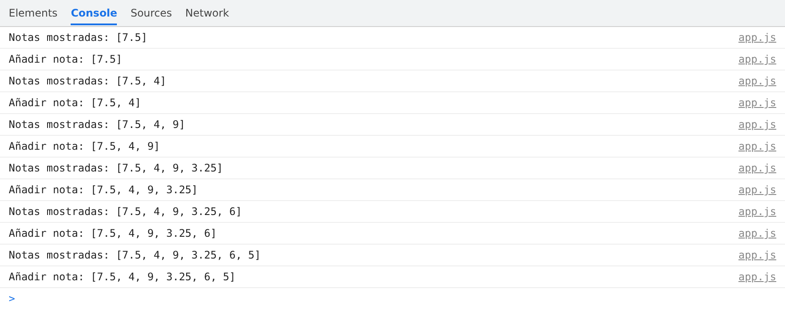<br>
      <sub>Consola con las notas añadidas.</sub>
    </td>
  </tr>
</table>
</div>

**Resultado:** cada nota que se añade aparece como una etiqueta verde si está aprobada o roja si está suspensa, y la media se recalcula al momento, junto con el número de notas. Solo se aceptan notas entre 0 y 10: si se escribe otra, aparece el error «La nota debe ser entre 0 y 10.». La media se muestra con dos decimales; con las notas de la captura (7.5, 4, 9, 3.25, 6 y 5) sale 5.79. El botón «Borrar» elimina todas las notas para volver a empezar.

### Ejercicio 5 · map, filter y reduce

**Objetivo:** aplicar `map`, `filter` y `reduce` sobre el array `numeros` (del 1 al 10), primero por separado y después encadenados.

<div align="center">
<table>
  <tr>
    <td align="center">
      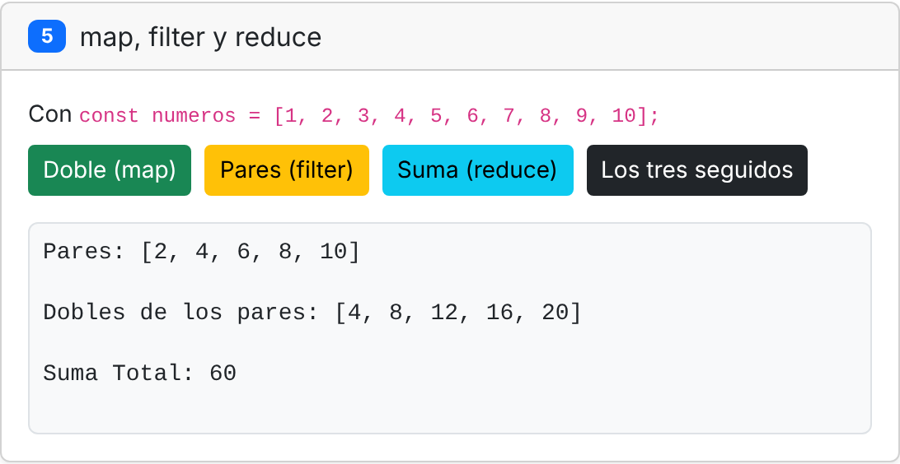<br>
      <sub>El resultado del botón «Los tres seguidos».</sub>
    </td>
  </tr>
  <tr>
    <td align="center">
      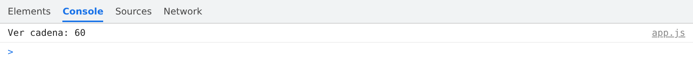<br>
      <sub>Consola tras pulsar «Los tres seguidos».</sub>
    </td>
  </tr>
</table>
</div>

**Resultado:**

- **Doble (map):** devuelve un array nuevo con cada número multiplicado por 2.
- **Pares (filter):** devuelve un array nuevo solo con los números pares.
- **Suma (reduce):** recorre el array acumulando cada número en un total.
- **Los tres seguidos:** primero `filter` saca los pares (`[2, 4, 6, 8, 10]`), después `map` calcula sus dobles (`[4, 8, 12, 16, 20]`) y, por último, `reduce` suma esos dobles: **60**.

Un detalle curioso que descubrí durante la práctica: `reduce` no está pensado solo para sumar. Hace lo que diga la función que recibe; como la mía usa el operador `+`, si el array tuviera textos en lugar de números, los concatenaría.

### Ejercicio 6 · Ciudades: slice, splice y búsqueda

**Objetivo:** mostrar las ciudades con su índice, comparar `slice` con `splice` y buscar una ciudad con `includes` e `indexOf`.

<div align="center">
<table>
  <tr>
    <td align="center">
      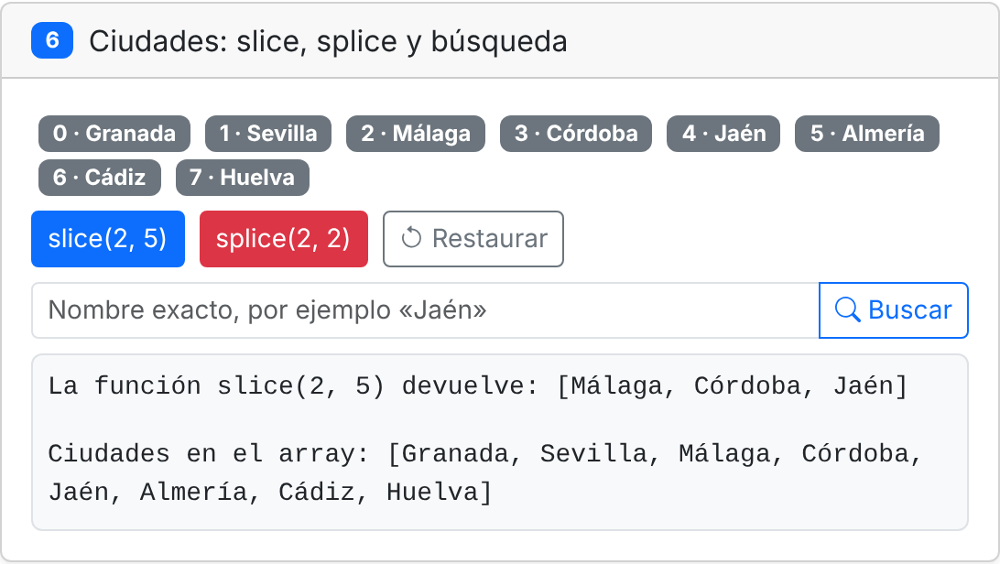<br>
      <sub>Con <code>slice(2, 5)</code>.</sub>
    </td>
  </tr>
  <tr>
    <td align="center">
      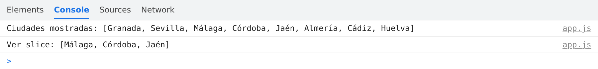<br>
      <sub>Consola tras <code>slice(2, 5)</code>.</sub>
    </td>
  </tr>
  <tr>
    <td align="center">
      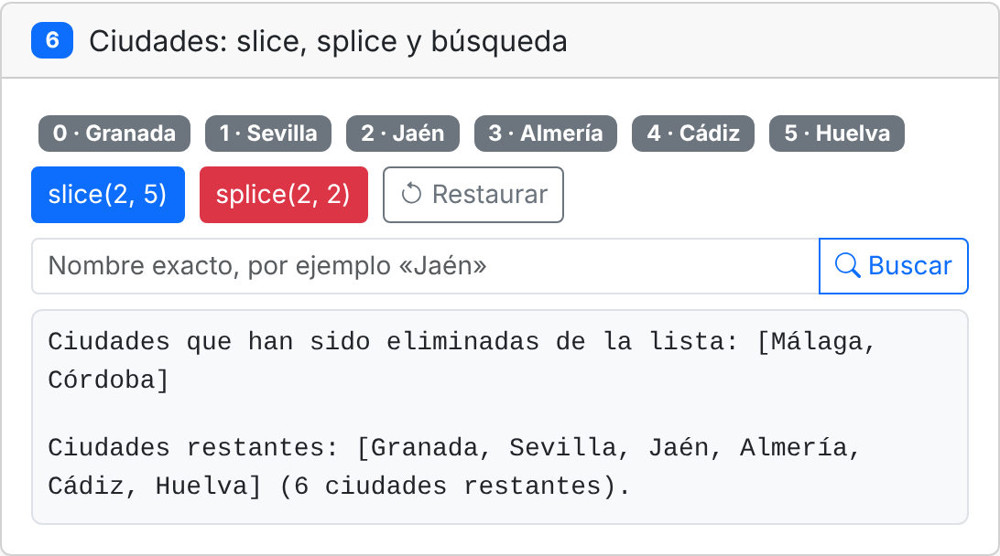<br>
      <sub>Con <code>splice(2, 2)</code>.</sub>
    </td>
  </tr>
  <tr>
    <td align="center">
      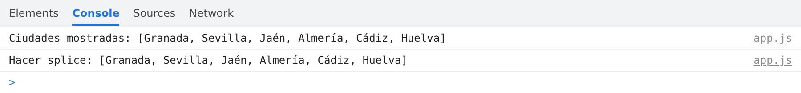<br>
      <sub>Consola tras <code>splice(2, 2)</code>.</sub>
    </td>
  </tr>
  <tr>
    <td align="center">
      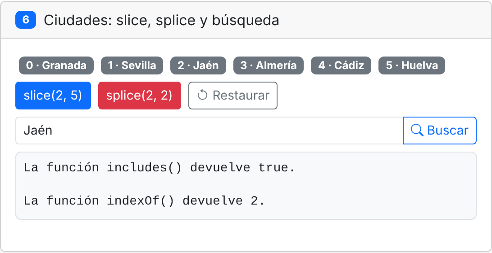<br>
      <sub>Búsqueda de «Jaén» después del <code>splice</code>.</sub>
    </td>
  </tr>
  <tr>
    <td align="center">
      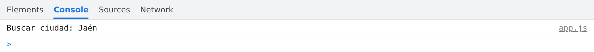<br>
      <sub>Consola tras buscar «Jaén».</sub>
    </td>
  </tr>
</table>
</div>

**Resultado:** cada ciudad se pinta como una etiqueta (*badge*) con su índice y su nombre, para ver en qué posición está cada una.

- **slice(2, 5):** devuelve las ciudades desde el índice 2 hasta el 5, sin incluir este último: `[Málaga, Córdoba, Jaén]`. El array no cambia y sigue teniendo sus ocho ciudades.
- **splice(2, 2):** elimina dos elementos a partir del índice 2 y los devuelve: `[Málaga, Córdoba]`. El array sí cambia y se queda con seis ciudades.
- **Buscar:** se escribe el nombre exacto de una ciudad. Al buscar «Jaén» después del `splice`, `includes()` devuelve `true` e `indexOf()` devuelve `2`. Antes estaba en la posición 4, pero al quitar Málaga y Córdoba las ciudades siguientes se desplazan dos posiciones.

---

## Reflexión

Ha sido una práctica muy interesante para trabajar con arrays y con los distintos métodos que ofrecen. El ejercicio 6 deja clara la diferencia entre `slice` y `splice`: `slice(2, 5)` solo obtiene una copia de un trozo del array (tres elementos, del índice 2 al 4) y no lo modifica, mientras que `splice(2, 2)` quita del array dos elementos a partir del índice 2 (Málaga y Córdoba) y los devuelve, así que el array original sí cambia.

Por eso en el ejercicio 3 ordeno una copia: `sort` modifica el array sobre el que se usa, así que si ordenara `productos` directamente, al pulsar «Todos» ya no saldrían en su orden original, sino ordenados por precio.

---

## Uso de IA

He utilizado **Claude** (Anthropic) para:

- **Comentar el código** de `app.js`.
- **Revisar el código**: comprobar que cumple lo que pide la rúbrica y que no tiene errores.
- **Este README**: la estructura, el formato, la revisión ortográfica y la redacción, a partir de mi redacción original.

---

## Fuentes

- [W3Schools · JavaScript Tutorial](https://www.w3schools.com/js/)
- [MDN Web Docs · JavaScript](https://developer.mozilla.org/es/docs/Web/JavaScript)
