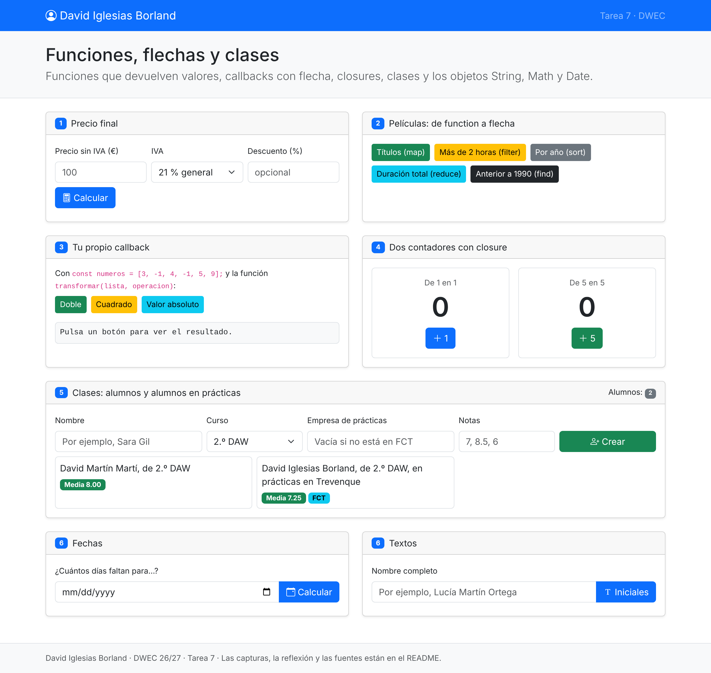
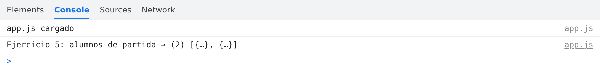
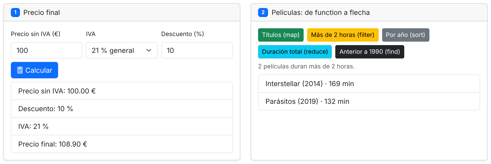
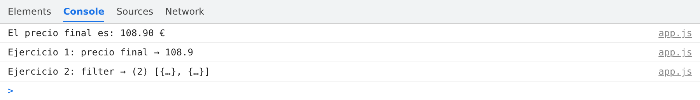
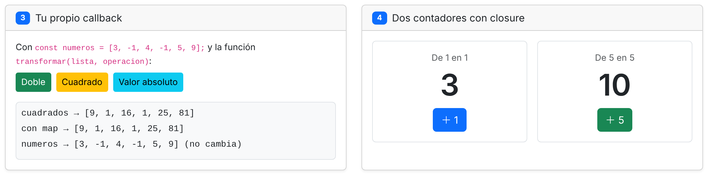
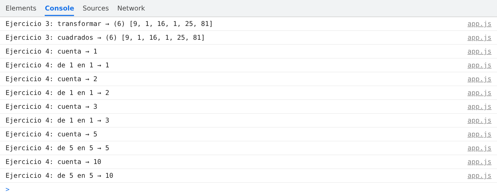
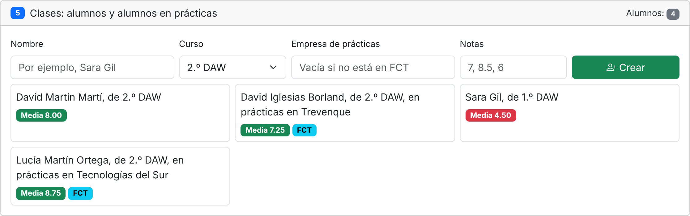
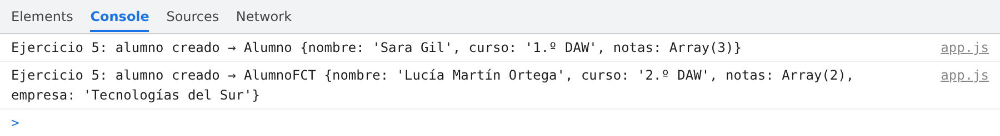
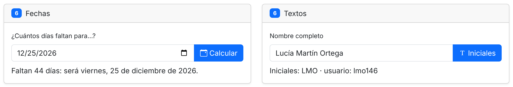
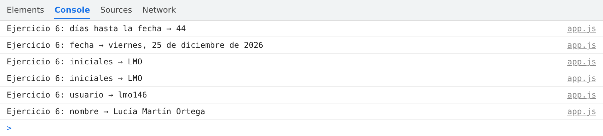

# Tarea 7 · Funciones, flechas y clases

| | |
|---|---|
| **Autor** | David Iglesias Borland |
| **Módulo** | Desarrollo Web en Entorno Cliente (DWEC) |
| **Curso** | 2.º DAW · 2026-27 |

---

## Índice

1. [Descripción](#descripción)
2. [Estructura de carpetas](#estructura-de-carpetas)
3. [Vista general](#vista-general)
4. [Ejercicios](#ejercicios)
   - [Ejercicios 1 y 2 · El precio y las películas](#ejercicios-1-y-2--el-precio-y-las-películas)
   - [Ejercicios 3 y 4 · Mi propio callback y los contadores](#ejercicios-3-y-4--mi-propio-callback-y-los-contadores)
   - [Ejercicio 5 · Los alumnos](#ejercicio-5--los-alumnos)
   - [Ejercicio 6 · Fechas y textos](#ejercicio-6--fechas-y-textos)
5. [Reflexión](#reflexión)
6. [Uso de IA](#uso-de-ia)
7. [Fuentes](#fuentes)

---

## Descripción

Página web con JavaScript para practicar funciones que devuelven valores, parámetros por defecto, callbacks con funciones flecha, closures, clases con herencia y los objetos `String`, `Math` y `Date`. Los callbacks están escritos con flecha, los métodos de las clases con la forma corta (nunca con flecha) y las funciones de los botones con `function`. Para probarla, basta con abrir la carpeta en VS Code, pulsar **Go Live** y usar los botones con la consola abierta (F12).

---

## Estructura de carpetas

```text
tema07/
├── capturas/
│   ├── a-pagina.png
│   ├── a-pagina-2.png
│   ├── b-ej1-ej2.png
│   ├── b-ej1-ej2-2.png
│   ├── c-ej3-ej4.png
│   ├── c-ej3-ej4-2.png
│   ├── d-ej5-clases.png
│   ├── d-ej5-clases-2.png
│   ├── e-ej6-fechas-textos.png
│   └── e-ej6-fechas-textos-2.png
├── js/
│   └── app.js        # Una función por cada botón de la página
├── index.html        # Una tarjeta por ejercicio (el 6 tiene dos)
└── README.md
```

---

## Vista general

<div align="center">
<table>
  <tr>
    <td align="center">
      <br>
      <sub><b>a)</b> La página recién cargada: mi nombre en la barra superior y las tarjetas de los seis ejercicios.</sub>
    </td>
  </tr>
  <tr>
    <td align="center">
      <br>
      <sub>Consola al cargar la página.</sub>
    </td>
  </tr>
</table>
</div>

Nada más cargar la página se ve mi nombre en la barra de navegación y las tarjetas de los seis ejercicios. En el ejercicio 5 ya aparecen los dos alumnos de partida: **David Martín Martí** (un `Alumno`, con media 8.00) y **David Iglesias Borland** (un `AlumnoFCT`, en prácticas en Trevenque, con media 7.25). La consola muestra «app.js cargado» y el array con esos dos alumnos.

---

## Ejercicios

### Ejercicios 1 y 2 · El precio y las películas

**Objetivo:** calcular el precio final de un producto con una función que devuelve un valor y usa parámetros por defecto, y pasar a flecha los callbacks de `map`, `filter`, `sort`, `reduce` y `find` sobre un array de películas.

<div align="center">
<table>
  <tr>
    <td align="center">
      <br>
      <sub>Un precio de 100 € con un 10 % de descuento y el 21 % de IVA, y el botón «Más de 2 horas (filter)».</sub>
    </td>
  </tr>
  <tr>
    <td align="center">
      <br>
      <sub>Consola con el precio final y las películas filtradas.</sub>
    </td>
  </tr>
</table>
</div>

**Resultado (precio):** el trabajo está repartido entre dos funciones:

- `calcularPrecio(base, iva = 21, descuento = 0)` solo calcula y **devuelve** el precio final: primero resta el descuento y después suma el IVA. Gracias a los valores por defecto, `calcularPrecio(100)` devuelve 121.
- `mostrarPrecio()` es la función del botón: lee el formulario, valida los datos, llama a `calcularPrecio()` y pinta el desglose. Si el descuento está vacío, llama a `calcularPrecio()` sin tercer argumento para que se use el 0 por defecto.

Con 100 € de base, un 10 % de descuento y el 21 % de IVA: 100 − 10 = 90 y 90 + 18,90 = **108,90 €**. Si la base está vacía o es negativa, aparece el aviso «La base no puede estar vacía o ser negativa.», y si el descuento no está entre 0 y 100, «El descuento tiene que estar entre 0 y 100.».

**Resultado (películas):** todos los callbacks están escritos como funciones flecha de una sola expresión, sin llaves ni `return`. «Más de 2 horas» usa `filter` con `(pelicula) => pelicula.duracion > 120` y muestra las dos películas que lo cumplen: *Interstellar* (169 min) y *Parásitos* (132 min). «Por año» ordena una copia con `sort`, porque `sort` modifica el array original.

### Ejercicios 3 y 4 · Mi propio callback y los contadores

**Objetivo:** escribir una función `transformar(lista, operacion)` que reciba un callback y haga a mano lo mismo que `map`, y crear dos contadores independientes con un closure.

<div align="center">
<table>
  <tr>
    <td align="center">
      <br>
      <sub>El botón «Cuadrado» y los contadores tras pulsar tres veces «+1» y dos veces «+5».</sub>
    </td>
  </tr>
  <tr>
    <td align="center">
      <br>
      <sub>Consola con el resultado de <code>transformar</code> y cada paso de los contadores.</sub>
    </td>
  </tr>
</table>
</div>

**Resultado (callback):** `transformar()` crea un array vacío, recorre la lista con `for...of`, aplica a cada elemento la función `operacion` que recibe y guarda el resultado con `push`. Al final devuelve ese array nuevo, así que `numeros` no cambia. Con «Cuadrado» (`(n) => n ** 2`), `[3, -1, 4, -1, 5, 9]` se convierte en `[9, 1, 16, 1, 25, 81]`, el mismo resultado que da `map`. En «Valor absoluto» se pasa `Math.abs` directamente, sin paréntesis, porque ya es una función.

**Resultado (contadores):** `crearContador(paso = 1)` declara una variable `cuenta` y devuelve una función flecha que la incrementa. Esa función **recuerda** su propia `cuenta` y su `paso` aunque `crearContador()` ya haya terminado: eso es un closure. Como cada llamada a `crearContador()` crea una variable `cuenta` nueva, `contarDeUno` y `contarDeCinco` no se mezclan: tras tres clics en «+1» y dos en «+5», uno marca **3** y el otro **10**.

### Ejercicio 5 · Los alumnos

**Objetivo:** crear una clase `Alumno` y una clase hija `AlumnoFCT` para los alumnos en prácticas, y crear alumnos nuevos desde el formulario.

<div align="center">
<table>
  <tr>
    <td align="center">
      <br>
      <sub>Cuatro alumnos: los dos de partida y dos creados desde el formulario, uno de ellos en prácticas.</sub>
    </td>
  </tr>
  <tr>
    <td align="center">
      <br>
      <sub>Consola con un <code>Alumno</code> y un <code>AlumnoFCT</code> recién creados.</sub>
    </td>
  </tr>
</table>
</div>

**Resultado:** `Alumno` guarda el nombre, el curso y sus notas, y tiene los métodos `anadirNota()`, `media()` y `presentarse()`. `AlumnoFCT` hereda de `Alumno` con `extends`, llama primero a `super(nombre, curso)` y añade la empresa. Además, sobrescribe `presentarse()` aprovechando la frase de la clase madre con `super.presentarse()`.

Para decidir qué crear, `crearAlumno()` mira el campo de la empresa: **si está vacío, crea un `Alumno`; si tiene texto, crea un `AlumnoFCT`**. Las notas se escriben separadas por comas y se convierten en números con `split` y `map`. Si alguna no es un número entre 0 y 10, aparece un aviso y no se crea el alumno.

En la captura se han añadido *Sara Gil* (1.º DAW, sin empresa, notas 4, 3.5 y 6, media 4.50 en rojo) y *Lucía Martín Ortega* (2.º DAW, en prácticas en Tecnologías del Sur, notas 8 y 9.5, media 8.75). Los alumnos en prácticas llevan la etiqueta **FCT**, que se decide con `instanceof AlumnoFCT`, y el contador sube a 4.

### Ejercicio 6 · Fechas y textos

**Objetivo:** calcular los días que faltan para una fecha con `Date` y `Math`, y obtener las iniciales de un nombre y un nombre de usuario con los métodos de `String`.

<div align="center">
<table>
  <tr>
    <td align="center">
      <br>
      <sub>Los días que faltan para el 25 de diciembre de 2026 y las iniciales de «Lucía Martín Ortega».</sub>
    </td>
  </tr>
  <tr>
    <td align="center">
      <br>
      <sub>Consola con los días, la fecha, las iniciales y el usuario.</sub>
    </td>
  </tr>
</table>
</div>

**Resultado (fechas):** probando el 25 de diciembre de 2026 desde el 11 de noviembre de 2026, la página dice «Faltan 44 días: será viernes, 25 de diciembre de 2026.». `diasHasta()` pone la hora de hoy a las 00:00, resta las dos fechas (que da milisegundos) y divide entre los milisegundos de un día. El resultado se **redondea con `Math.round`** porque, si entre las dos fechas hay un cambio de hora, ese día dura 23 o 25 horas y la división no daría un número entero. En este caso no hay cambio de hora entre medias (el de otoño fue en octubre), así que la división ya da 44 justos. Al convertir el texto del campo en un `Date` se resta 1 al mes, porque en JavaScript los meses van de 0 a 11.

**Resultado (textos):** `iniciales()` quita los espacios de los extremos con `trim`, separa las palabras con `split(" ")`, descarta las vacías con `filter` (por si hay espacios dobles), se queda con la primera letra de cada una en mayúscula y las une con `join`: «Lucía Martín Ortega» → **LMO**. `crearUsuario()` añade las iniciales en minúscula y tres cifras al azar con `Math.random`, rellenadas con ceros con `padStart`. En la captura ha salido **lmo146**; cada vez sale un número distinto.

---

## Reflexión

Al pasar un callback de `function` a flecha, el código queda más corto: si el cuerpo es una sola expresión, se pueden quitar las llaves y el `return`, porque la flecha devuelve esa expresión directamente, como en `peliculas.filter((pelicula) => pelicula.duracion > 120)`. El `return` hace falta en cuanto se abren llaves, como en la flecha que devuelve `crearContador()`, que tiene dos instrucciones y termina con `return cuenta`.

Un método, en cambio, no se escribe con flecha porque la flecha no tiene su propio `this`: toma el del sitio donde se escribió. Si `media()` o `presentarse()` fueran flechas, `this` no apuntaría al alumno y no podrían leer `this.notas` ni `this.nombre`. Por eso en las clases `Alumno` y `AlumnoFCT` los métodos van con la forma corta y las flechas se quedan para los callbacks, como el de `reduce` dentro de `media()`.

---

## Uso de IA

He utilizado **Claude** (Anthropic) para:

- **Comentar el código** de `app.js`.
- **Revisar el código**: comprobar que cumple lo que pide la rúbrica y que no tiene errores.
- **Este README**: la estructura, el formato, la revisión ortográfica y la redacción, a partir de mi redacción original.

---

## Fuentes

- [W3Schools · JavaScript Tutorial](https://www.w3schools.com/js/)
- [MDN Web Docs · JavaScript](https://developer.mozilla.org/es/docs/Web/JavaScript)
